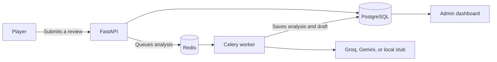

<div align="center">

# Review AI Dashboard

### Player feedback, AI analysis, and a clear support workflow


**One review form for players. One dashboard for the support team.**

[Features](#features) · [How it works](#how-it-works) · [Quick start](#quick-start) · [Quality checks](#quality-checks)

</div>

---

## Features

| For players | For support operators |
| :--- | :--- |
| A focused form for name, email, and review | A review queue with filters and sorting |
| Inline validation and submission feedback | AI rating, priority, category, and draft reply |
| An About dialog in Ukrainian and English | Statistics, CSV export, status updates, and draft regeneration |

The public page contains **one feedback form**. The CS2-themed images and sample reviews provide context; case opening, inventory, and withdrawals are not implemented in this app.

## How it works



The API accepts a review immediately. The worker analyzes it in the background; the operator manages its `Pending` → `Processing` → `Completed` status. The AI provider can be Groq, Gemini, or the offline stub used by the local Compose setup.

## Quick start

**Requirement:** Docker with Compose. From the repository root:

```sh
docker compose up --build -d
```

| Page | Local address |
| :--- | :--- |
| Feedback form | [localhost:8080](http://localhost:8080) |
| Admin login | [localhost:8080/admin/login](http://localhost:8080/admin/login) |

**Local demo login:** `admin-artem-leo` / `password-artem-leo`.

Compose starts PostgreSQL, Redis, the web app, and one Celery worker. An empty database receives **100 demo reviews** (29 Ukrainian, no Russian reviews). The database is stored in a Docker volume, so restarts do not duplicate the sample data.

```sh
docker compose ps      # Check service health
docker compose logs -f # Follow logs
docker compose down    # Stop; keep database data
```

To verify the main flow, submit a review, sign in, and open it in the dashboard. After the worker processes it, check the AI draft; then try the status control, filters, statistics, and CSV export. The About dialog switches between `UA` and `EN`.

## Quality checks

Backend (Python 3.11+, from `backend/`):

```sh
pip install -r requirements-dev.txt ruff==0.17.2 mypy==2.4.0
pytest
ruff check .
ruff format --check .
mypy app main.py scripts
```

Frontend (Node 20, from `frontend/`):

```sh
npm ci
npx eslint . --max-warnings 0
npm run format:check
npm run type-check
npm test
npm run build
```

The backend tests use temporary SQLite databases and require at least 90% coverage. The root `Dockerfile` builds the web image; deployment also needs PostgreSQL, Redis, and a separate worker. Set deployment secrets through environment variables listed in [.env.example](.env.example), never in committed files.

## License

You may view, run, and evaluate this project. Other uses require the author's written permission; see [LICENSE](LICENSE).
